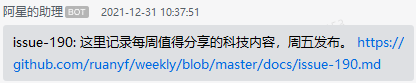

<!-- START doctoc generated TOC please keep comment here to allow auto update -->
<!-- DON'T EDIT THIS SECTION, INSTEAD RE-RUN doctoc TO UPDATE -->
**Table of Contents**  *generated with [DocToc](https://github.com/thlorenz/doctoc)*

- [Ruanyf Weekly RSS Push](#ruanyf-weekly-rss-push)
  - [Introduction](#introduction)
  - [Features](#features)
  - [Setup](#setup)
  - [AI Content Analysis](#ai-content-analysis)
  - [Preview](#preview)
  - [Acknowledgments](#acknowledgments)
  - [License](#license)

<!-- END doctoc generated TOC please keep comment here to allow auto update -->

# Ruanyf Weekly RSS Push

[English](README.md) | [中文](README_zh.md)

## Introduction

A Go-based service that automatically pushes updates from Ruanyf's Weekly RSS feed to Slack and WeCom (WeChat Work). Built with GitHub Actions for automated execution.

## Features

- Automated RSS feed monitoring
- Push notifications to:
  - Slack
  - WeCom (WeChat Work)
- AI-powered content analysis and recommendation extraction
- Runs on GitHub Actions
- Written in Go for better performance

## Setup

1. Fork this repository
2. Add the following secrets in your repository's Settings -> Secrets and Variables -> Actions:
   - `SLACK_URL`: Slack Webhook URL (for Slack notifications)
   - `WECOM_URL`: WeCom Webhook URL (for WeCom notifications)
   - `ARK_BASE_URL`: (Optional) Base URL for Ark API
   - `ARK_API_KEY`: Ark AI API key (for AI content analysis)
   - `ARK_MODEL_ID`: Model ID for Ark API
3. GitHub Actions will automatically run according to the preset schedule

## AI Content Analysis

This service includes AI-powered content analysis that:

- Extracts the 5 most valuable recommendations from each weekly issue
- Analyzes content for practical value, novelty, and technology trends
- Adds these recommendations to your notifications
- Uses the Ark API (similar to OpenAI API)

To disable the AI feature, simply don't set the `ARK_API_KEY` environment variable.

## Preview

## Acknowledgments

- [ruanyf/weekly](https://github.com/ruanyf/weekly)
- Original issue discussion: [issue-190](https://github.com/ruanyf/weekly/issues/2132)

## License

MIT License
